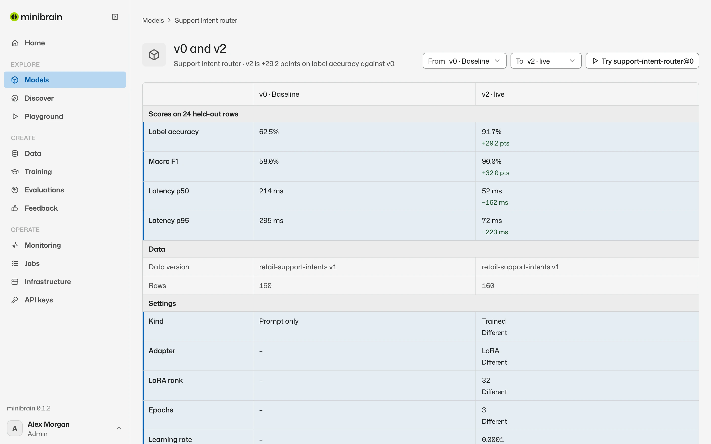

<div align="center">

# minibrain

**Train, evaluate and serve models of any size on your own data.**<br>
On your own hardware or cloud, under your control.

[](https://github.com/getminibrain/minibrain/actions/workflows/ci.yml)
[](https://github.com/getminibrain/minibrain/releases)
[](https://getminibrain.com/docs/install/verify-release)
[](https://github.com/getminibrain/minibrain/blob/main/LICENSE)

[Docs](https://getminibrain.com/docs) · [Quickstart](https://getminibrain.com/docs/get-started/quickstart) ·
[Install](https://getminibrain.com/docs/get-started/installation) · [API](https://getminibrain.com/docs/api/overview) ·
[Changelog](https://github.com/getminibrain/minibrain/blob/main/CHANGELOG.md) ·
[Roadmap](https://github.com/getminibrain/minibrain/blob/main/ROADMAP.md)

<picture>
  <source media="(prefers-color-scheme: dark)" srcset="https://raw.githubusercontent.com/getminibrain/minibrain/main/docs/assets/evaluation-dark.webp">
  
</picture>

</div>

---

minibrain turns your data into models you own. Point it at a dataset, score a prompt-only baseline, train only when
the numbers say it pays, and serve the winner on an OpenAI-compatible endpoint. Your data stays on your infrastructure.

- **Any size.** From a fast task model to a private frontier endpoint, on the base model that fits the job.
- **Eval first.** Every model starts as a scored baseline; each trained version is compared on the same held-out rows.
- **Private by default.** It runs on your infrastructure from signed releases, and fully air-gapped when you need it.
- **Yours to keep.** Weights, data, scores and logs stay on your infrastructure; export a model at any time.

## Quick start

On Linux, or a Mac with Apple silicon:

```sh
curl -LsSf https://getminibrain.com/install.sh | sh
minibrain serve
```

1. Open the setup link it prints and create the admin account.
2. Open **Models** and click **Try with demo data**. minibrain adds a demo dataset and a model on Qwen3 0.6B, and
   scores version 0, the prompt-only baseline.
3. Click **Deploy**, create a key under **Use › API Connect**, and call the model with any OpenAI client:

```python
from openai import OpenAI

client = OpenAI(base_url="http://127.0.0.1:8000/v1", api_key="mb_...")
reply = client.chat.completions.create(
    model="demo-travel-intents",
    messages=[{"role": "user", "content": "My suitcase did not arrive"}],
)
print(reply.choices[0].message.content)
```

Next, train a version on your own data: [Your first model](https://getminibrain.com/docs/get-started/first-model).

<details>
<summary>Other ways to run it</summary>

```sh
uvx --python 3.12 minibrain serve                     # straight from PyPI with uv
pip install minibrain && minibrain serve              # any Python 3.12 or 3.13

docker run --name minibrain -p 127.0.0.1:8000:8000 -v minibrain-data:/data \
  ghcr.io/getminibrain/minibrain                      # CPU

docker run -d --name minibrain --gpus all --shm-size 8g -p 127.0.0.1:8000:8000 -v minibrain-data:/data \
  ghcr.io/getminibrain/minibrain:cuda                 # NVIDIA GPUs
```

In Docker, `docker logs minibrain | grep setup` finds the setup link. Requirements, PyTorch backends, Compose,
air-gapped installs, upgrades and signature checks are in the
[install guide](https://getminibrain.com/docs/install/requirements).

</details>

## How it works

| | Step | What happens |
|---|---|---|
| 1 | **Add data** | Upload files, or read databases, buckets and lakehouse tables in place. Held-out rows are set aside for scoring. |
| 2 | **Add a model** | Pick a base model, a dataset and a preset (classify, extract, rewrite, write SQL, answer), or your own output: labels, JSON or free text. |
| 3 | **Baseline** | Version 0, the base model plus instructions, is scored at once. |
| 4 | **Train** | Start a run. The new version is scored on the same held-out rows and compared with version 0. |
| 5 | **Deploy** | Deploy the version that wins; the API name now routes to it. |
| 6 | **Improve** | Reviewed feedback and new data lead to the next version. |

## What's inside

| | |
|---|---|
| [Data](https://getminibrain.com/docs/guides/data) | CSV, TSV, JSON, JSON Lines and Parquet files, server folders, S3, PostgreSQL, MySQL, Iceberg and Delta Lake tables, shaped with SQL into versioned datasets, with quality and personal-data checks |
| [Base models](https://getminibrain.com/docs/guides/models) | A reviewed catalogue of open models, or any model from Hugging Face, an S3 bucket or a folder, with the fit on your machines shown before you download |
| [Training](https://getminibrain.com/docs/guides/training) | LoRA, QLoRA and full fine-tuning, DPO on feedback pairs and GRPO with your graders as rewards, planned to fit the memory of the machine that trains |
| [Evaluation](https://getminibrain.com/docs/guides/evaluation) | A scored baseline, every version on the same held-out rows, built-in graders and a judge model, reference models side by side, and a model card for each version |
| [Serving](https://getminibrain.com/docs/guides/deployments) | SGLang, vLLM, MLX, transformers or llama.cpp behind one OpenAI-compatible API, with replicas across pools of machines and rollback to any version |
| [Feedback](https://getminibrain.com/docs/guides/feedback) | Ratings and corrections from the Playground or your app, reviewed, then trained into the next version |
| [Operations](https://getminibrain.com/docs/guides/monitoring) | A request log, Prometheus metrics, OpenTelemetry and JSON logs, Docker Compose and Helm, and several main servers on Postgres |
| [Security](https://getminibrain.com/security) | Single sign-on, roles, encryption at rest with your own key manager, a tamper-evident audit log, network policies and signed releases |

## The API

Any OpenAI client works: chat and text completions, streaming,
[structured output](https://getminibrain.com/docs/api/structured-output),
[tool calling](https://getminibrain.com/docs/api/tool-calling) and
[reasoning](https://getminibrain.com/docs/api/reasoning).

- `support-triage` follows the live version; `support-triage@2` pins one.
- Keys start with `mb_` and name the models they may call.
- An MCP server lets Claude, Cursor and other agents run minibrain with an API key.

Details: [API overview](https://getminibrain.com/docs/api/overview).

## Scale out

One command runs everything on one machine. The same package adds machines as you grow:

| Command | Runs |
|---|---|
| `minibrain serve` | Main: UI, API, gateway, a job worker and one engine per base model |
| `minibrain worker --main http://main:8000 --pool gpu` | A GPU worker on another machine, pulling jobs from main |
| `minibrain gateway --main-url http://main:8000 --port 8100` | A standalone `/v1` gateway that keeps answering while main restarts |

Base models come from Hugging Face or a mirror, an S3 bucket, or a local folder; `MINIBRAIN_OFFLINE=1` turns off
every outbound call. The steps for a production layout are in
[Production setup](https://getminibrain.com/docs/install/production).

## Security and help

- **Found a vulnerability?** Report it in private: see
  [SECURITY.md](https://github.com/getminibrain/minibrain/blob/main/SECURITY.md).
- **Check a release** before you install it: [Verify a release](https://getminibrain.com/docs/install/verify-release).
- **Stuck?** Start with [Troubleshooting](https://getminibrain.com/docs/reference/troubleshooting), then open an
  [issue](https://github.com/getminibrain/minibrain/issues).
- **Want a first model built with you, on your own data?** [Talk to us](https://getminibrain.com/#talk), or write to
  hello@getminibrain.com.

## Develop

Needs [uv](https://docs.astral.sh/uv/), Node with pnpm, and [mise](https://mise.jdx.dev).

```sh
mise run setup    # install Python and web dependencies
mise run dev      # API and worker on :8000, UI with hot reload on :5173
mise run check    # tests, ruff, pyright, biome, tsc
mise run build    # wheel with the built UI inside
mise run e2e      # the core journey in a browser, with fake serving and jobs
```

`mise run setup-link` prints a fresh link to create the first admin; `mise run api-types` regenerates the TypeScript
client after API changes.

## License

[Apache-2.0](https://github.com/getminibrain/minibrain/blob/main/LICENSE)
