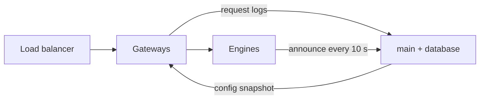
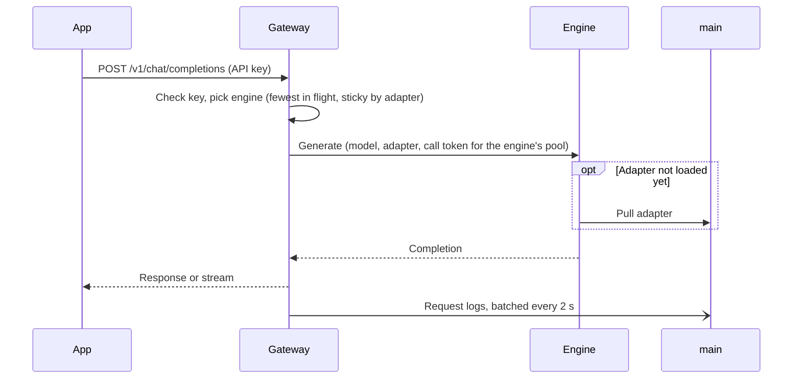
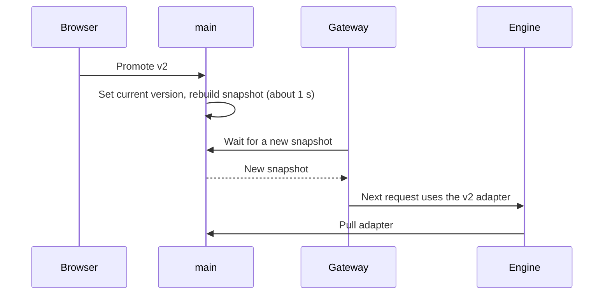
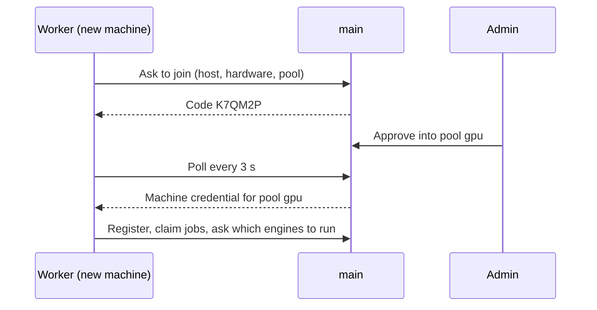
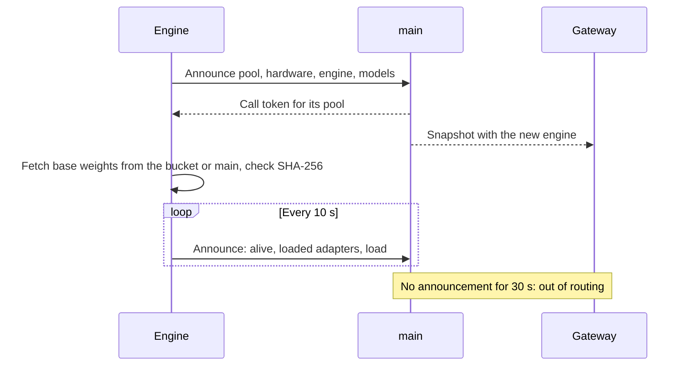

Inference runs on the serving plane: gateways check API keys and route each request, and engines run the models. main
publishes the configuration they use but is not on the request path, so a request never touches the database and
serving carries on while main restarts.

## Control and serving planes

- main publishes a versioned configuration snapshot: routes, current versions, API key hashes and expiry, the engine
  replicas of each model, and which models keep request inputs.
- Gateways keep the last good snapshot on disk and serve from it. A main outage or upgrade pauses the UI and new jobs,
  not inference.
- Promoting or rolling back a version publishes a new snapshot; gateways pick it up within about a second.

## The request path

| Step | Where the gateway finds it |
|---|---|
| API key, scope and expiry | The snapshot in memory (key hashes) |
| Route, version and adapter | The same snapshot |
| Engine replicas for the model | The same snapshot, kept current by engine announcements |
| Which replica | The gateway's own memory: requests in flight, sticky bindings, health checks every 5 seconds |
| Request log and the key's last use | Buffered and written in batches about every 2 seconds |

- Configuration is up to about a second stale: a revoked key stays valid for at most a second.
- Chat and text completions run on their own threads, at most `MINIBRAIN_GATEWAY_CONCURRENCY` at once (64 by
  default), apart from the threads of the UI, workers and jobs. One more gets a 503 with `Retry-After` at once rather
  than waiting, so model traffic never slows the rest of main ([Errors](../api/overview.md#busy-and-starting-models)).
- To scale out, add gateways behind HAProxy, Envoy or a cloud load balancer, then add engines. GPUs are the bottleneck
  long before gateways or the database.
- How a gateway picks among replicas: [Deployments](../guides/deployments.md).

## Engines

One engine process serves one base model with many adapters. It picks its inference engine when it starts, from the
machine's hardware and the model's weight format:

| Machine | Weights | Engine |
|---|---|---|
| Linux with NVIDIA or AMD (ROCm), SGLang installed | safetensors | SGLang, adapters loaded at runtime |
| Linux with NVIDIA or AMD (ROCm), vLLM installed, no SGLang | safetensors | vLLM, with runtime LoRA updates |
| Apple silicon with `minibrain[mlx]` | safetensors | MLX, adapters swapped per request |
| Anything else | safetensors | `transformers` with PEFT |
| Any machine with `minibrain[llamacpp]` | GGUF | llama.cpp (Metal, CUDA or CPU); base models only |

- `minibrain engine --engine` overrides the choice. An automatic choice that fails to load falls back to
  `transformers`.
- Engines of different kinds serve side by side: an engine on MLX on a Mac and one on SGLang on a rack can be replicas
  of the same model.
- SGLang and vLLM pin their own torch and CUDA, so each runs from its own environment: point
  `MINIBRAIN_SGLANG_PYTHON` or `MINIBRAIN_VLLM_PYTHON` at its Python. The vLLM engine has not been run on a GPU yet.
- main starts an engine on its own machine for a model deployed on the `local` pool when no live replica there serves
  it. A model with versions but no deployment, or a safety model, gets one when no replica serves it anywhere. A model
  deployed on another pool never starts on main.
- Workers start and stop engines for the models deployed to their pool. To serve one model on a machine without a
  worker, run [`minibrain engine`](cli.md#minibrain-engine).

### Weights on other machines

An engine on another machine pulls adapters from main and base weights from wherever Storage keeps them, never from
Hugging Face. With a bucket, main hands out a signed link per file and the engine reads the bucket directly; with a
folder, it reads the files from main. It keeps a working copy under `engines/` in `MINIBRAIN_HOME`, checks every file's
size and SHA-256, and removes copies of models main no longer has.

While it fetches, Infrastructure and the Models list say "Fetching weights" and the engine logs its progress every 30
seconds. A `/v1` call to a model that is still fetching or loading waits up to 5 seconds, then gets a 503 with
`Retry-After: 10` that says how far the fetch is. A fetch that fails says so and loads nothing.

## When main is down

| Part | Does |
|---|---|
| UI, `/api`, new jobs, deploys, API key changes | Wait for main |
| Gateway and engines inside `minibrain serve` | Stop with main |
| Standalone gateways (`minibrain gateway`) | Serve from the last configuration they saved; keep up to 10,000 request log entries and send them when main is back |
| Engines on other machines | Keep serving; an adapter they have not loaded yet waits for main |
| Workers on other machines | Keep running their jobs, retry main every 30 seconds at most, and send the jobs' events later |
| Jobs on main's own worker | Stop with main and are retried; training resumes from its last checkpoint |

## Flows

### An inference request

### Deploying a version

### A machine joins by approval

The request lasts an hour. The worker saves the credential and reuses it on later starts until the machine is removed.
With the pool's join token the worker skips the approval. Steps: [Add machines](../install/machines.md).

### An engine joins

Engines answer only main and gateways. Every call to an engine, its health check included, carries a call token for the
engine's pool: an HMAC-SHA256 of the pool name keyed with the gateway token, so main and gateways work it out
themselves and an engine learns it from main's answer to its announcement. A call without it, or with another
pool's, gets 401 and runs nothing; an engine that has not heard from main yet answers 503. The token is not the
gateway token, so a machine that holds it can call the engines of its own pool but cannot read main's configuration
or another pool's engines.
